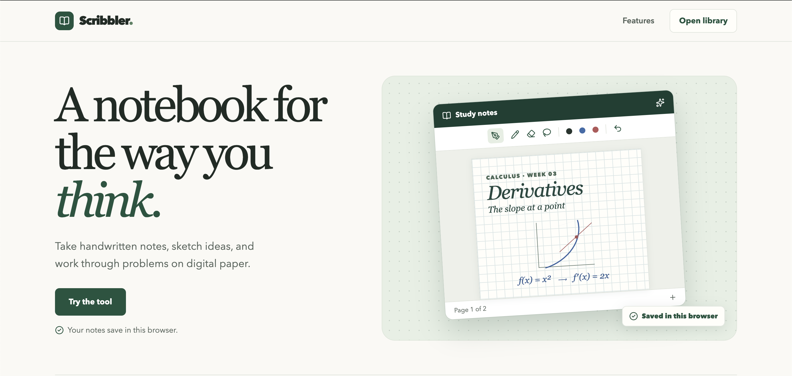

# Scribbler

[Open Scribbler on Vercel](https://scribblernotebook.vercel.app/)



Scribbler is a browser notebook for handwritten notes and study. Create and organize folders and notes from the library, search and sort notes, and move them with drag-and-drop or bulk actions. Add note tags and bookmarks, then make page-linked flashcards or short-answer practice questions for manual review. Notes save automatically in the current browser; deleted notes remain recoverable in Trash until you empty it. The editor supports ink, text boxes, page thumbnails, page reordering, duplication and deletion with undo, local page imports, PDF export, keyboard shortcuts, and two-finger pan and zoom. Tool keys default to Q/W/E/R/T/Y and can be changed in the in-editor shortcut guide; these preferences stay in this browser. Save failures explain when browser storage is full or unavailable. The library can export and restore a full Scribbler backup, including Trash and study material.

## Run locally

Requires Node.js 22 or newer.

```sh
npm ci
npm run dev
```

Open [localhost:3000](http://localhost:3000). Use `npm run build` to create a production build and `npm start` to serve it.

## How it fits together

- `app/` defines the landing page, library, and note routes.
- `components/editor.tsx` coordinates pages, tool settings, import/export, and save feedback. `components/ink-canvas.tsx` handles drawing, text boxes, selection, and page panning.
- `lib/ink.ts` holds drawing and hit detection. `lib/files.ts` renders local imports and PDFs. `lib/notebooks.ts` owns the notebook model and IndexedDB transactions.

Select the active Eraser again to choose between removing a whole stroke and erasing only the part you touch. Undo and redo apply to page edits on the current page and reset when the editor closes. Imported page images and tool settings are local to this browser profile and site address; they do not sync to other devices. Use **Back up** in the library to save a portable `.scribbler` archive, and **Restore** to merge one into the current library.

## AI tutor

Open **AI tutor** in the editor or select strokes or text boxes with Lasso and choose **Ask AI** to attach them. The local demo streams sample replies. The live option sends rendered note pages to Amazon Nova Lite through a same-origin Vercel Function; the first live send asks for confirmation. Chat lasts until you leave or reload the note. See the [tutor context decision](docs/adr/0006-on-demand-ai-tutor-context.md).

### Enable Nova Lite on a private Vercel preview

1. In AWS Settings, confirm the selected Region and check your credits in **Billing**. Verify in-Region support for **Amazon Nova Lite** (`amazon.nova-lite-v1:0`) and try a sample prompt in Bedrock Playground.
2. In Vercel, enable **Vercel Authentication** for previews and verify access in a signed-out browser. Leave preview bypasses off. Enable OIDC federation with the Team issuer.
3. Follow [Vercel's AWS OIDC guide](https://vercel.com/docs/oidc/aws) to create the IAM provider and role. Use the exact trust subject `owner:<TEAM>:project:<PROJECT>:environment:preview` and the audience `https://vercel.com/<TEAM>`. Grant only `bedrock:InvokeModelWithResponseStream` on `arn:aws:bedrock:<REGION>::foundation-model/amazon.nova-lite-v1:0` in the selected Region.
4. In **Settings → Environment Variables**, turn on [automatic exposure of system environment variables](https://vercel.com/docs/environment-variables/system-environment-variables). Add these variables to the **Preview** environment for the tutor branch only:

   ```text
   AWS_REGION=<selected AWS project Region>
   AWS_ROLE_ARN=<preview OIDC role ARN>
   NEXT_PUBLIC_AI_TUTOR_MODE=live
   AI_TUTOR_ENABLED=true
   ```

5. Redeploy and confirm a signed-out request to `/api/ai-tutor` cannot reach the route. Sign in and test with a throwaway note containing handwriting. Confirm first-send consent, streamed replies and a follow-up. Check AWS Billing after the smoke test.

OIDC gives the function temporary credentials. The route requires Vercel's `VERCEL_ENV=preview` and the server enable flag. Public production and local development use the demo. Keep Bedrock model invocation logging off for note content. To pause the preview, disable the live flags and redeploy. Revoke the role's Bedrock permission to stop older previews immediately.

## Vercel

Import the repository as a Next.js project. The frontend needs no environment variables. See [Next.js on Vercel](https://vercel.com/docs/frameworks/full-stack/nextjs).
